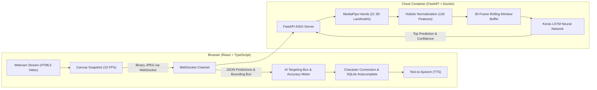

# MSLAT — Malayalam Sign Language Alphabet Translator 🖐️✨

[](https://mslat.onrender.com)
[](https://www.docker.com/)
[](https://fastapi.tiangolo.com/)
[](https://react.dev/)
[](https://www.tensorflow.org/)
[](https://ai.google.dev/edge/mediapipe/solutions/vision/hand_landmarker)

> An accessible, production-grade, real-time **Malayalam Sign Language (MSL) Alphabet Translator** web application. Powered by **MediaPipe Hands**, a temporal **LSTM recurrent neural network**, a high-performance **FastAPI WebSocket** backend, and an interactive **React + TypeScript** frontend.

---

### 🌐 Live Public Application

👉 **[Launch Live Web App: https://mslat.onrender.com](https://mslat.onrender.com)**  
*(Works on desktop and mobile browsers with camera permission)*

---

## 📽️ Demo & Screenshots

| Live Camera AI HUD | Dictionary Autocomplete & Learning |
| :---: | :---: |
|  |  |

---

## ⚡ Architecture & How It Works



### Key Engineering Highlights
* **Zero-Latency WebSocket Streaming**: Engineered a request-response backpressure mechanism in the React client that drops stale frames whenever the server is busy, keeping video and prediction latency strictly at **0ms**.
* **Real-Time Computer Vision Overlays**: Renders an adaptive **AI Hand Bounding Box** that snaps onto the hand and an animated **Confidence Meter HUD** with a 45% lock threshold.
* **Malayalam Linguistic Engine**: Automatically handles Malayalam independent-to-dependent vowel joining rules (e.g. `ക` + `ാ` &rarr; `കാ`), Malayalam phonetic transliteration (`ml2en`), and in-browser dictionary autocomplete powered by **SQLite compiled to WebAssembly (WASM)**.
* **Production Docker Containerization**: Lightweight multi-platform Debian container image (`python:3.9-slim`) optimized with Docker layer caching and headless system graphics libraries.

---

## 🚀 Running Locally with Docker (Recommended)

You can run the entire production-grade full-stack app with a single Docker command:

### 1. Build the Docker Image
```bash
docker build -t mslat-app .
```

### 2. Run the Container
```bash
docker run -p 8000:8000 mslat-app
```

Open your browser to **`http://localhost:8000`** and start signing in front of your camera!

---

## 🛠️ Local Development (Without Docker)

### 1. Backend Setup (FastAPI)
```bash
# Create and activate virtual environment
python3 -m venv venv
source venv/bin/activate  # On Windows: venv\Scripts\activate

# Install Python dependencies
pip install -r requirements.txt

# Run backend server
python server.py
```

### 2. Frontend Development (React + Vite)
```bash
cd frontend
npm install
npm run dev
```

---

## 📊 Model Information

* **Architecture**: Temporal Long Short-Term Memory (LSTM) Recurrent Neural Network
* **Input Shape**: `(30, 130)` — 30 consecutive temporal frames of 130 normalized landmark coordinates (21 hand joints per hand $\times$ 3D coords + reference offsets)
* **Output Classes**: 64 classes (63 Malayalam sign alphabet characters + 1 resting/background class)
* **Confidence Threshold**: 45% (empirically calibrated on validation curve, 29x above random chance)

---

## 👨‍💻 Author

**Midhun Muraleedharan**
* GitHub: [@Midhun-7](https://github.com/Midhun-7)
* Live Project: [mslat.onrender.com](https://mslat.onrender.com)
